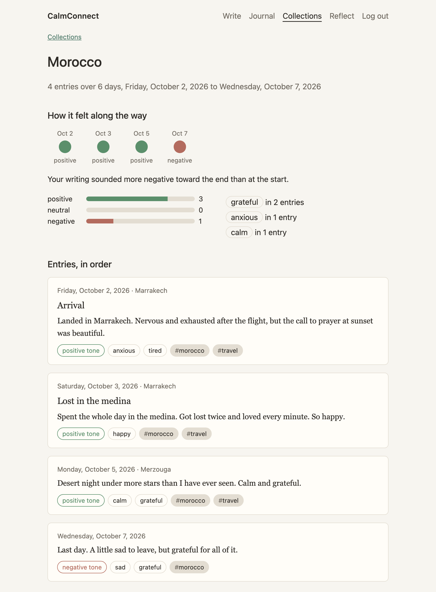
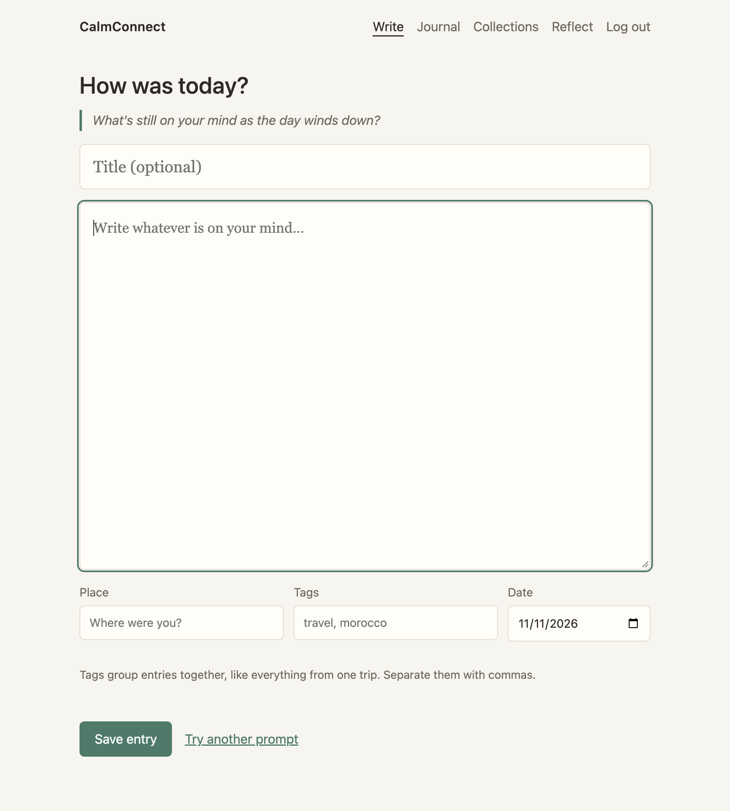
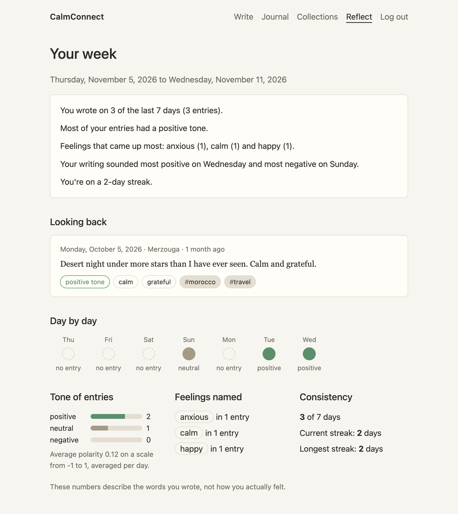

# CalmConnect

CalmConnect started as a small personal project because I wanted somewhere to write down my thoughts at the end of the day. Over time it turned into a way to keep track of little moments, notice how I was feeling, and come back to experiences I didn't want to forget.

I'm studying abroad this semester, and that's when it started to matter more to me. When I look back on these months, I want to remember more than photos and itineraries. I want to remember what the days actually felt like.

So this is a private journal that runs on my own laptop. I can write from the terminal or the browser, tag entries by trip, and later read a whole trip back in order. It does some light analysis of the words I write, but it isn't a therapist or a chatbot, and it doesn't pretend to know how I feel.


<sub>A trip collection in the browser (sample entries).</sub>

## What it does

- Write, edit and delete entries. Each one can have a title, a place and tags, and you can backdate an entry if you missed a day.
- If you don't know where to start, it can give you a prompt.
- Every tag becomes a collection. Tag entries `morocco` or `copenhagen` and you can read that trip from start to finish, with a small timeline of how the tone of your writing changed along the way.
- Search text, titles and places, and filter by tag or date.
- A weekly reflection shows which days you wrote, the mix of tones, the feelings that came up most and your streaks, summed up in a few plain sentences.
- "Looking back" brings up an older entry, preferring one from this day in an earlier year.

## How the analysis works

I wanted something small enough that I could explain every part of it, so there's no machine learning model here.

Each entry gets two separate readings. The tone (positive, neutral or negative) comes from [TextBlob](https://textblob.readthedocs.io/)'s polarity score, which goes from -1 to 1. Anything between -0.1 and 0.1 counts as neutral.

Feelings (happy, calm, grateful, sad, anxious, angry, tired) come from a short word list in [`app/analysis.py`](app/analysis.py). It matches whole words, so "unhappy" isn't happy and "downtown" isn't "down". It also skips a feeling if "not", "never", "don't" or something similar shows up a few words before it in the same clause, so in "I wasn't sad, just tired", only tired counts.

The two readings can disagree, and that's fine. "Exhausted but proud of today" is positive in tone and still tired.

For the weekly numbers, each day's tone is the average of that day's entries, and every day counts the same. Otherwise one rough day with five entries would outweigh the rest of the week.

## Getting started

You'll need Python 3.10 or newer.

```bash
git clone https://github.com/krishishah05/CalmConnect
cd CalmConnect
python -m venv .venv && source .venv/bin/activate
pip install -e .
```

That installs Flask, TextBlob and Rich and gives you a `calmconnect` command. Everything is saved in `./data` (your journal, a generated secret key and your CLI login), and git ignores that folder. [`.env.example`](.env.example) lists the optional settings.

## From the terminal

```bash
calmconnect register
calmconnect journal                              # type freely, finish with Ctrl-D
calmconnect journal --prompt
calmconnect journal "Rainy day by the canal." --place Copenhagen --tags travel,copenhagen
calmconnect journal "Finally writing about Saturday." --date 2026-11-07

calmconnect history --tag copenhagen --oldest    # read a trip in order
calmconnect history -s bakery                    # search text, titles and places
calmconnect history --on 2026-10-02
calmconnect show 12
calmconnect edit 12                              # opens $EDITOR
calmconnect edit 12 --tags travel,morocco
calmconnect delete 12

calmconnect reflect                              # your week, plus an older entry
calmconnect stats
calmconnect tags morocco
```

Here's `calmconnect tags morocco` after a trip:

```
#morocco  4 entries, 2026-10-01 to 2026-10-06

 Oct 1     Oct 2     Oct 4     Oct 6
positive  positive  positive  negative
Your writing sounded more negative toward the end than at the start.
Feelings named most: grateful (2), anxious (1), calm (1)
```

Every command has `--help`. If you don't want to install it, `python -m cli.main` works the same way from the project folder.

## In the browser

```bash
flask --app api.main run
```

Then open http://127.0.0.1:5000 and make an account. There are four pages: Write, Journal, Collections and Reflect. It's plain HTML and CSS with no JavaScript, works on a phone, and follows your system's dark mode.

<p>
  
  
</p>

There's also a Dockerfile and `docker-compose.yml` if you'd rather run it in a container (`docker compose up --build`). I mostly run CalmConnect directly on my laptop, so the Docker setup is less tested.

## The API

The same Flask app has a JSON API under `/api`. Log in once to get a token, then send it as `Authorization: Bearer <token>`.

```bash
curl -X POST localhost:5000/api/tokens -H "Content-Type: application/json" \
     -d '{"username": "krishi", "password": "a long password"}'
```

| Route | What it does |
| --- | --- |
| `POST /api/register` | Create an account (`username`, `password`) |
| `POST /api/tokens` | Log in and get a token, valid for 30 days |
| `DELETE /api/tokens/current` | Log out by revoking the token |
| `GET /api/entries` | List entries. Optional: `q`, `tag`, `from`, `to`, `order=newest\|oldest`, `limit` (1 to 100), `offset` |
| `POST /api/entries` | Create an entry: `text`, plus optional `title`, `place`, `tags`, `date`, `prompt` |
| `GET`, `PATCH`, `DELETE /api/entries/<id>` | Read, change (any of `text`, `title`, `place`, `tags`, `date`) or delete one entry |
| `GET /api/tags` | Your tags, with entry counts and date ranges |
| `GET /api/tags/<tag>` | One collection: its entries in order, a timeline and a tone summary |
| `GET /api/stats` | The weekly summary and streaks |
| `GET /api/revisit` | An older entry to look back on |

Errors come back as `{"error": "..."}`. If you ask for someone else's entry, you get the same 404 as for one that doesn't exist.

## Privacy

Journal entries are personal, so I tried to be careful here:

- Passwords are hashed with scrypt (through Werkzeug), and there are no built-in accounts or default passwords.
- The browser, CLI and API all log in with the same kind of token. Only a SHA-256 hash of each token is stored, tokens expire after 30 days, and logging out deletes them.
- Tokens never go in URLs. The browser keeps its token in a signed HttpOnly cookie, and every form has a CSRF token.
- Every database query that touches entries is limited to the logged-in user.
- The `data` folder is created so only your OS user can read it, and the CLI can't act as another person without their password.
- The server runs without debug mode and only listens on 127.0.0.1 unless you change it.

## Tests

```bash
python -m unittest discover tests
```

They cover the analysis edge cases, entry validation, search and filters, streaks and weekly stats around date boundaries, trip collections after edits and deletes, migrating an old database, logins, keeping users' journals separate, and the API, web pages and CLI end to end.

## How the code is laid out

```
app/analysis.py   tone and feelings for a piece of text
app/auth.py       accounts, password hashing and login tokens
app/journal.py    validation and journal operations used by every interface
app/stats.py      streaks, weekly summaries and collection summaries
app/storage.py    SQLite schema and queries
api/main.py       Flask app setup and the JSON API
api/web.py        browser pages (templates/ and static/ sit next to it)
cli/main.py       the calmconnect command
tests/            one test file per area
docs/screenshots  the images in this README
```

## Limitations

- The analysis only looks at words. It misses sarcasm, slang, emoji and most non-English writing, and any feeling that isn't in the word list. TextBlob also gets some sentences wrong: "I don't feel anxious anymore" comes out slightly negative. Treat it as a rough summary of what you wrote, not a judgement about anyone's mental health.
- Negation is simple. It only looks a few words back, so "Not only happy but relieved" gets misread.
- "Today" follows the clock of the computer running CalmConnect. That's fine for a personal setup, but it isn't built for a shared server with people in different timezones.
- Entries aren't encrypted on disk, there's no rate limiting on login, and Flask's built-in server isn't meant for the public internet. It's meant to run on your own machine.

## Upgrading from the first version

The first version saved entries under a plain name with no accounts. When the new version opens an old database, it moves those rows to a `legacy_entries` table instead of deleting them. Make an account, then run:

```bash
calmconnect import-legacy <the name you used before>
```

Entries come across with their original text and date and get re-analysed with the current rules. The old version didn't save times, so imported entries show midnight UTC.
